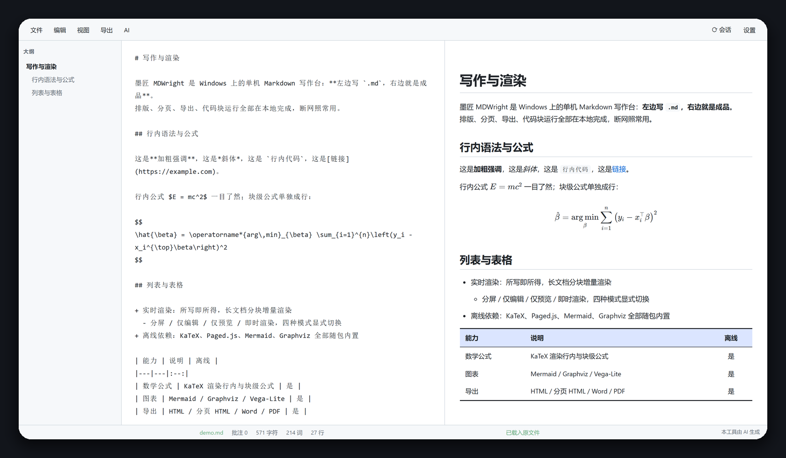
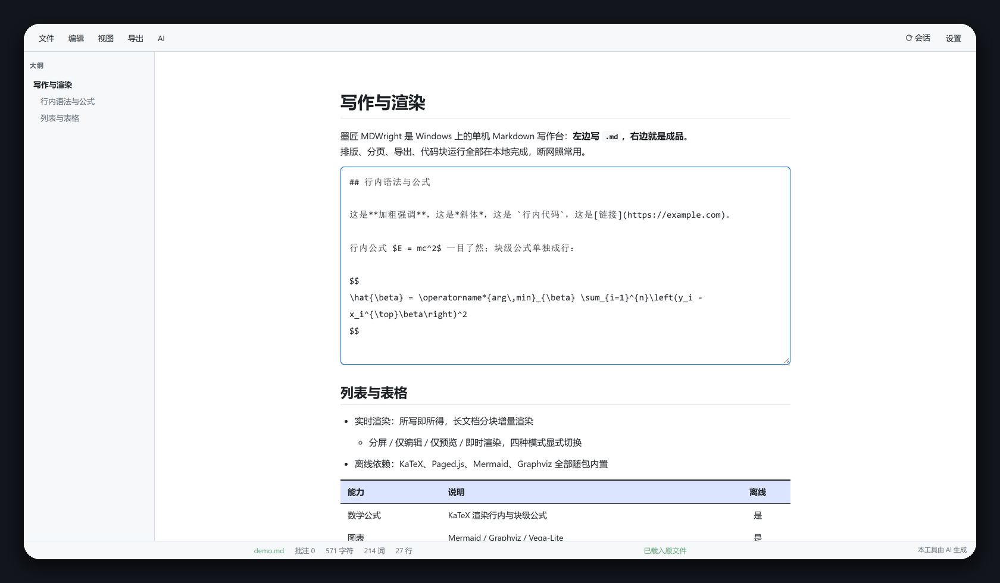
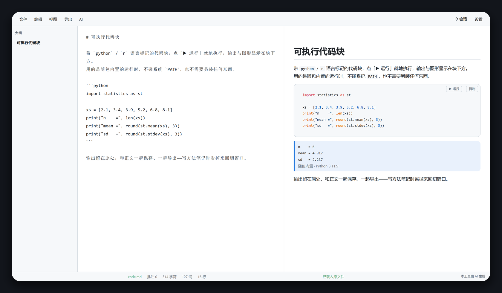
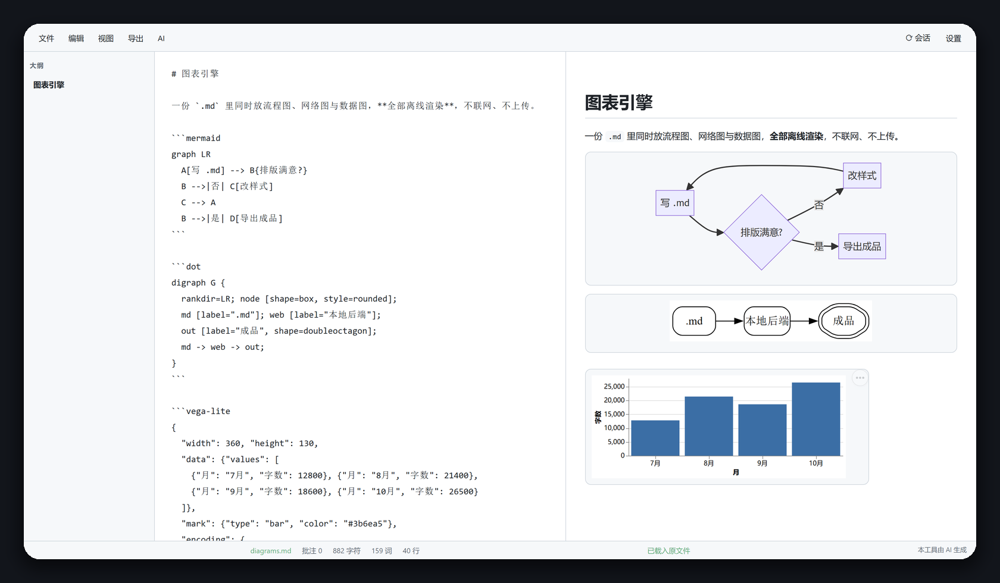

# 墨匠 MDWright

**Windows 上的单机 Markdown 写作台。** 左侧写、右侧即时渲染；排版、分页、导出、代码块运行全部在本地完成，断网照常用。

> **中文名「墨匠」** = 墨（Markdown 的 M）+ 匠（-wright）。桌面端的写作与成书排版工具：**不做公众号排版，也不是 Markdown linter**。

> **本项目的来路**：MDWright 是基于 **[MDEditor](https://github.com/Ldxs001/maby_tool) v2.0** 的衍生开发，不是从零开始的新项目。
> 编辑器内核、本地文件服务、`.smd` 自包含格式与安装脚本均源自上游，此后在其上继续演进并更名为 MDWright。
> 上游仓库：<https://github.com/Ldxs001/maby_tool>（同样以 AGPL-3.0-or-later 发布）。



---

## 它解决什么问题

用 Word 写技术文档，公式、代码、图表的排版会反复返工；用在线编辑器，稿子不在自己机器上，断网就干不了活。MDWright 把两件事分开：**写作体验按 Markdown 的来，输出质量按排版的来**——`.md` 是唯一事实来源，PDF / Word 是从它渲染出来的成品。

- **零安装依赖**：程序自带便携 Python 运行时，双击即用，不需要另装解释器、不需要管理员权限。
- **零联网依赖**：KaTeX、Paged.js、Mermaid、Graphviz、WaveDrom、Vega-Lite 全部随包内置，数学公式与图表离线渲染。
- **零数据上传**：文档读写走本地后端（`127.0.0.1`），AI 润色默认接本地模型（LM Studio / Ollama）。

## 功能

| 能力 | 说明 |
|---|---|
| 实时渲染 | 分屏 / 仅编辑 / 仅预览 / 即时渲染（点段即改，块内直接写源码）四种模式显式切换 |
| 数学公式 | KaTeX 离线渲染，行内 `$…$` 与块级 `$$…$$` |
| 图表 | Mermaid（流程/时序/状态/类）、Graphviz `dot`、WaveDrom 时序图、Vega-Lite 数据图 |
| 排版 | 逐元素字体/字号、段落缩进、对齐、表格样式、页面纸张与页边距，全部可视化配置 |
| 分页导出 | Paged.js 组版，纸张、页边距、页码、自动目录、目录独占一页；「导出 → 打印（分页 HTML）」生成成品并交给系统浏览器，浏览器里打印或存为 PDF |
| Word 导出 | 经 pandoc 转 `.docx`，保留标题层级与公式 |
| PDF 直出 | 调本机 Chromium 内核浏览器（Edge / Chrome）无头打印，边距与页码按当前设置 |
| 批注 | 选区批注，随文档保存，可逐条跳转 |
| 右键菜单 | 撤销/恢复 · 剪切/复制/粘贴 · 标题 / 强调 / 块 / 插入（二级菜单）· 运行选中代码 |
| 中英混排 | 汉字与英文/数字之间渲染时自动补空格，预览与导出同步（源文不动） |
| AI 润色 | 接本地 LM Studio / Ollama，也支持 OpenAI 兼容端点与 DeepSeek |
| 可执行代码块 | 带 `r` / `python` 语言标记的代码块带「▶ 运行」，输出与图形显示在块下方 |
| 自包含文档 | `.smd` 把正文、图片、批注打包成单个文件，跨机器取用要素齐全 |
| 多开 | 多个窗口/标签共享一个后端进程，文件各自独立 |

下面两张是真实界面（左边在正文里点一段就地改源码，右边是代码块跑完的样子）：

| 即时渲染：点中一段，就地展开该段源码 | 可执行代码块：点「▶ 运行」，输出留在块下方 |
|---|---|
|  |  |

## 与上游 MDEditor 的关系

本工具基于上游 **[MDEditor](https://github.com/Ldxs001/maby_tool) v2.0.0** 的基线快照继续开发——仓库的第一个提交就是那份状态。解析内核、分块增量渲染、KaTeX 公式、排版面板、Paged.js 分页导出、`.smd` 自包含文档、选区批注、本地 LLM 润色（LM Studio / Ollama）、四种本地图表引擎（Mermaid / Graphviz / WaveDrom / Vega-Lite）、内嵌窗口与安装包，都来自这里，**不是本项目的成果**。上文「功能」一表把它们也算进去了，但不必记在这条线上。

上游此后也一直在更新，`MarkdownEditor-app` 现在到 v2.6.13。**上游后来做出的能力，补进本工具的，记在上游名下**；下面按来源分两张表，免得把别人的工作算到这里。

### 一、从上游补入的（不算本项目原创）

| 能力 | 上游出处 | 本工具现状 |
|---|---|---|
| 图片排版三件套：单图对齐、多图并排、图段不参与正文首行缩进 | v2.3.0「图片排版三件套（段锚定 / 对齐体系 / `@@fill` 分栏）」 | 已补入，写法按本工具的习惯落地：`{N c}` / `{c}` / `{l}` / `{r}` 对齐，`@@ begin fill {a\|b}` … `@@ end fill` 并排（上游写作 `@@fill`）。导出 Word 时并排落成同一段落内的多行内图，不带表格框线 |
| 上下标 | 上游同名能力 | 已补入，两种写法都认：`^x^` / `~x~`（旧写法）与 `^{}` / `_{}`（上游 v2.6.10 起改用的写法，v3.2.4 跟进）；公式与行内代码里的 `^{}` 不动 |

### 二、本工具自己做的（v2.1.0 起）

| 方向 | 内容 |
|---|---|
| Markdown 方言 | 脚注、Callout 五型（NOTE/TIP/IMPORTANT/WARNING/CAUTION）、`==高亮==`、`^{}` / `_{}` 上下标（与旧的 `^x^` / `~x~` 并存）、定义列表、YAML front matter；预览 / 独立 HTML / 分页 PDF / Word 四条链路各实现一遍并对齐口径 |
| 代码高亮 | highlight.js 懒加载（仅按围栏语言着色，主题跟随明暗）+ 代码块复制按钮（导出时剥离，不进成品） |
| Word 导出 | pandoc 转换、公式 LaTeX→OMML（Word 里可继续编辑）、导出后注入 `tblBorders` 做三线表、运行输出按「语言 + 代码原文」匹配带入 |
| PDF 直出 | 本机 Edge / Chrome 无头打印，单会话 CDP 且等分页完成再 `printToPDF`，不留半截文件 |
| 可执行代码块 | R（Rscript、控制台语义、ggplot 就地出图）、Python（随包内置 3.11.9 或指定本机解释器）、同文档常驻会话变量跨块、结果落盘 `runs/` 并进 Word |
| 外部工具 | pandoc / 浏览器 / Rscript / Python 的探测与手工指定路径，缺失即置灰并说明原因 |
| AI | DeepSeek 升为一等后端（地址与模型预设、`reasoner` 不传采样参数） |
| 写作交互 | 菜单栏 + 统一设置面板、编辑区右键菜单、中英混排补空格（只作用于渲染与导出）、视图四态显式下拉、`Ctrl+S` |
| 排版 | 三线表与表头底色默认开启；Word 表格也是三线表 |
| 稳定性 | 后端掉线自愈（提示条 + 2.5 秒重连 + 内嵌桥重启后端）；测试收敛到 `tests/` + 统一 runner（55 个用例，浏览器级真跑） |

### 三、名字一样、来源不同，别混着看

- **Word / docx 导出**：本工具走 **pandoc**（`md_pandoc.py`），导出后改 `word/document.xml` 补三线表；上游 v2.3.0 是另一套（`docx_export.py` + 内置 docx 依赖）。两条链路不共用代码，也不是一次补入。
- **代码运行**：本工具是**围栏代码块 + 常驻会话**（`md_runs.py`）；上游那套叫 **low runner**——数据点 `@@ MDE…`、执行点、AI 生成 run 代码、独立解释器 `md-parser.js`。本工具没有这套，上游也没有本工具这套。

逐条的现象、根因、验证记录在 [CHANGELOG.md](CHANGELOG.md)；设计文档在 `docs/superpowers/plans/`（按轮次 R1–R5 留档）。

### Word 与 PDF：两种能直接交出去的成品

- **Word**：pandoc 转换，公式走 **LaTeX → OMML**，到 Word 里是可继续编辑的原生公式，不是图片。上游的方言在这里会原样露出记法，所以导出前先把 Callout、图片宽度、图表围栏改写成 pandoc 认得的 Markdown。
- **Word 的表格边框是自己写进去的**：pandoc 只给表格挂 `tblStyle`、不写任何显式边框，样式来自内置模板，排版面板的开关到不了 Word。导出后改 `word/document.xml`，按 OOXML 顺序注入 `tblBorders` 与表头行底边，改完用 `pandoc -f docx` 回读自检，读不出就判失败——不落打不开的文件。
- **Word 会带上代码块的运行输出**：按「语言 + 代码原文」从侧车匹配，命中才插入。代码改过就匹配不到，因此不会把过期结果贴进交付物。
- **PDF 直出**：调本机 Edge / Chrome 的无头模式打印，边距与页码沿用当前排版设置。走单会话 CDP 并**等分页完成再 `printToPDF`**，避免生成半截文件。

### 可执行代码块：从「一次性子进程」到「常驻会话」

- **R**：走本机 `Rscript`，**控制台语义**——`1:10`、`mtcars`、`mpg |> count(class)` 这种没写 `print()` 的裸表达式照样打印，赋值与 `library()` 不出声，ggplot 对象画到块下方。
- **Python**：两条运行时。留空用随包内置 3.11.9（只有标准库，换台机器行为一致）；填了本机解释器就用你那个环境（pandas / numpy 可用）。输出块下方会写明这次是谁跑的：`随包内置 · Python 3.11.9` 或 `本地解释器 · Python 3.14.5`。路径填错回落内置，不锁死功能。
- **常驻会话**：同一文档的同类代码块共用一个进程，前一块的 `df <- read.csv(...)` 后一块直接能用。超时（默认 60 秒）杀会话并在下次运行重建；同一文档并发运行第二块返回 409「上一块还在运行」；工具栏「⟳ 会话」清空变量。
- **结果落盘**：输出不再只活在预览 DOM 里——`.md` 存 `<文档名>.md.assets/runs/`，`.smd` 存包内 `runs/`，导出 Word 时从同一处取图。
- **选中就能跑**：选中一小段代码（含行内代码），浮动条上出现「▶ 运行」，语言按内容判定（出现 `import` / `def` / `print(` 按 Python，其余按 R），结果在弹窗里显示，不污染正文。

### 方言扩展：一处定义，四条链路都认

- 新增语法：**脚注**（文档级，编号按首次引用顺序）、**Callout 五型**（NOTE / TIP / IMPORTANT / WARNING / CAUTION）、**`==高亮==`**、**定义列表**、**YAML front matter**（剥离出正文，标题进导出）。上下标两种写法 `^x^` / `~x~` 与 `^{}` / `_{}` 都支持，按上游同步项算（见上表）。
- 「四条链路」指预览、独立 HTML、分页 / PDF、Word。同一份源文在四处走的是各自实现的同一套口径——新语法是四个地方各写一遍并各自回归，不是只把预览点亮。写坏了按原样显示，不吞字。
- 代码块加 **highlight.js 语法高亮**（懒加载，仅按围栏语言着色，主题跟随明暗）+ 右上角**复制按钮**（复制按钮在导出时剥离，不出现在成品里）。

### 交互与排版（本项目）

- **菜单栏替代工具栏**：文件 / 编辑 / 视图 / 导出 / AI 五档 + 设置，配置项收进一个面板；视图四态改成显式下拉，`Ctrl+S` 直接保存。
- **编辑区右键菜单**：撤销 / 恢复 / 剪切 / 复制 / 粘贴 + 标题 / 强调 / 块 / 插入四个二级菜单 + 运行选中代码，与工具栏共用同一套格式定义。
- **中英混排自动补空格**：`按Esc退出` 渲染为 `按 Esc 退出`；行内代码、代码块、公式、URL 一律不碰；**源文与落盘内容一个字节都不改**，Word 导出另走一条跳过围栏的实现，保证预览与成品一致。
- **后端掉线自愈**：本地后端被回收或崩掉时，界面不再只剩 `Failed to fetch`——挂一条带端口与状态的提示条，每 2.5 秒自动重连；内嵌窗口模式经 pywebview 桥请后端重新拉起（页面自己起不了进程）。

## 安装

### 方式一：安装包（推荐）

到本仓库的 **Releases** 页下载 `MDWright-Setup-vX.Y.Z.exe`，双击安装。

- 默认装到 `%LOCALAPPDATA%\MDWright`，**不需要管理员权限**，可在向导里改路径。
- 装完会自动注册：`.md` / `.smd` 右键菜单、双击关联、桌面与开始菜单快捷方式、「设置 → 应用」卸载条目。
- 卸载用开始菜单里的「Uninstall MDWright」，或「设置 → 应用 → MDWright」。

### 方式二：绿色版 / 从仓库直接运行

把整个仓库目录拷到任意位置（路径可含中文，但**不要放在需要管理员权限的目录**），然后：

```bat
python\pythonw.exe md_launch.pyw
```

或者双击 `MDWright.exe`（它只是转发参数给内置 pythonw 的启动器）。

想让右键菜单、快捷方式、文件关联一并生效，再执行一次：

```bat
install.cmd
```

> **不要直接双击 `mdwright.html`**。这个文件由本地后端服务提供，`file://` 方式打开没有后端，页面会提示你走正确入口。

## 外部工具路径：pandoc / 浏览器 / Rscript / Python

程序本身不需要任何外部工具就能写作和预览。四项功能依赖外部程序，**都支持手工指定路径**——装在不常见的位置、装了多个版本、或不想动 PATH，都填一下就行。

### 在哪里设置

工具栏 **「设置」→「外部工具」** 页签。五个输入框，右边实时显示探测到的版本：

| 输入框 | 对应功能 | 典型路径 |
|---|---|---|
| **pandoc（Word 导出）** | 导出 `.docx` | `C:\Program Files\Pandoc\pandoc.exe` |
| **浏览器（PDF 直出）** | 用 Chromium 内核无头打印 PDF | `C:\Program Files (x86)\Microsoft\Edge\Application\msedge.exe` |
| **Rscript（R 代码块）** | 运行带 `r` 标记的代码块、出图 | `C:\Program Files\R\R-4.4.1\bin\x64\Rscript.exe` |
| **Python（Python 代码块）** | 运行带 `python` 标记的代码块 | `C:\Users\你\AppData\Local\Programs\Python\Python312\python.exe` |
| **quarto（暂时不用）** | 预留位，本版没有功能消费 | — |

填的是**可执行文件的完整路径，带 `.exe`**，不要填目录。填完点「保存路径」。

### Python 是唯一例外：留空 = 用随包内置

其余工具留空就走自动探测，Python 不：

- **留空**（默认）→ 用随包内置的 3.11.9，只有标准库，`import pandas` 会失败。好处是**同一份 `.md` 换台机器行为一致**；
- **填了本机解释器路径** → 用那个环境，装了什么就能用什么（pandas / numpy 都行）。输出块下方会标明这次是谁跑的：`随包内置 · Python 3.11.9` 或 `本地解释器 · Python 3.14.5`；
- 路径填错 → 回落内置运行时，不会把功能锁死。

不做「自动探测 PATH 上的 Python」是有意的：那会让同一份文档在不同机器上跑出不同结果，而且用户不知道该找谁算账。要本地环境就显式填一次。

### 留空时怎么找

留空 = 自动探测，顺序如下：

1. `runtime/settings.json` 里 `tools.*` 填的路径（即上表）；
2. `PATH` 环境变量里的同名命令；
3. 常见安装目录：
   - pandoc：`%ProgramFiles%\Pandoc`、`%LOCALAPPDATA%\Pandoc`、`%ProgramData%\chocolatey\bin`，以及 **Quarto / RStudio 自带的 pandoc**（没单独装 pandoc 时最常命中）；
   - 浏览器：`%ProgramFiles(x86)%` 与 `%ProgramFiles%` 下的 Edge、Chrome；
   - R：注册表 `HKLM\SOFTWARE\R-core\R\<版本>\InstallPath` 登记的目录，再扫 `%ProgramFiles%\R\<最新版本>`。
4. 都找不到 → 对应按钮置灰，鼠标悬停给出缺失原因。**不会导出半成品**。

R 走注册表这一条是有意的：R 常常装在 `D:\` 这类非系统盘，只扫 `C:\Program Files` 永远扫不到。

### 填错了会怎样

**自动回落到默认**，不会把功能永久锁死——一次笔误不该让导出按钮消失。

判定方法很直接：输入框右侧显示的是**实际生效的那个程序**（版本号 + 完整路径）。如果显示的路径不是你填的那条，说明你填的那个没被采纳（路径不存在、或不是可执行文件），这时按显示的路径核对，或点「重新检测」再看一次。

### 直接改配置文件

设置面板写的就是这个文件，也可以用编辑器直接改：

```
<安装目录>\runtime\settings.json
```

```json
{
  "tools": {
    "pandoc_path": "",
    "rscript_path": "",
    "python_path": "",
    "quarto_path": "",
    "browser_path": ""
  }
}
```

- 留空字符串 = 走自动探测（Python 是例外：留空 = 用随包内置运行时）；
- 只认识这五个键，其余键在读入时丢弃；
- 非字符串值会被归成空串，不会让程序崩；
- 改完保存，回到设置面板点「重新检测」（或重启程序）生效。

> 路径里的反斜杠要写成 `\\`（JSON 转义），例如 `"rscript_path": "D:\\R-4.6.1\\bin\\x64\\Rscript.exe"`。

### 代码块怎么跑

带 `python` / `r` 语言标记的代码块，右上角有「▶ 运行」，输出与图形显示在块下方。

- **R**：走本机 `Rscript`，**控制台语义**——没写 `print()` 的裸表达式也会打印（`1:10`、`mtcars`、`mpg |> count(class)` 与在 R 控制台里敲一样）；赋值与 `library()` 不出声；ggplot 画到块下方；
- **Python**：留空用内置 3.11.9，填了本地路径就用你那个环境（见上文）。两条路线都只回 `stdout` / `stderr`，Python 块不出图——要画图用 R 代码块。

「编辑 → 插入代码块」往文档里写哪种围栏（R 还是 Python），在「设置 → 外观 → 编辑」里选，默认 R；已有代码块不受影响。

## 常用操作

| 操作 | 快捷键 / 入口 |
|---|---|
| 新建 | `Ctrl+N` |
| 保存 | `Ctrl+S`（无当前文件时弹另存为） |
| 带页码目录的成品 | 「导出 → 打印（分页 HTML）」，在打开的浏览器里打印或存 PDF |
| 内置文档 | 「文件」→ 内置文档 → 使用指南 |
| 视图切换 | 工具栏「视图」菜单（分屏 / 仅编辑 / 仅预览 / 即时渲染） |
| 右键菜单 | 编辑区点右键：撤销/恢复、剪切/复制/粘贴、标题/强调/块/插入（二级）、运行选中代码 |
| 退出后台 | 托盘图标右键，或 `md_stop.cmd` |

## 图表与分页




> README 里的截图都来自真实界面，不是画的示意图：`docs/screenshots/_make_screenshots.py` 起本地后端、用无头 Edge 驱动页面并截图，示例文档在 `docs/screenshots/demo/`。界面改了就跑一遍重出：

```bat
python\python.exe docs\screenshots\_make_screenshots.py
```

## 目录

```
md_launch.pyw          启动器：起后端、探活端口、拉起窗口
md_server.py           本地后端：文件读写、导出组版、批注、AI 路由、代码块执行
mdwright.html          编辑器界面（由后端提供，勿直接双击）
md_tools.py            外部工具探测（pandoc / 浏览器 / Rscript / quarto）
md_pandoc.py           Word 导出（pandoc 调用与预处理）
_smd.py                .smd 自包含文档格式
_splash.py             启动画面
md_app.pyw             WebView2 内嵌窗口模式
python/                内置便携 Python 运行时
docs/                  使用指南、版权与开源组件声明
docs/screenshots/      README 截图、示例文档与重录脚本
katex/ pagedjs/ mermaid/ viz/ wavedrom/ vega/ highlight/   离线前端依赖
installer/             安装包构建脚本（仅用系统自带 csc.exe）
tests/                 回归测试（浏览器级 / 导出 / 解析器，逐文件独立跑）
```

## 自己构建安装包

只需要 Windows 自带的 .NET Framework 编译器（`csc.exe`），没有第三方构建依赖：

```bat
python\python.exe installer\_build_installer.py
```

产物在 `_setup_out\MDWright-Setup-vX.Y.Z.exe`。版本号取自 `CHANGELOG.md` 的第一条 `## vX.Y.Z`。

## 致谢

这个项目站在别人的肩膀上，该说明的地方写清楚：

- **上游项目 MDEditor**（<https://github.com/Ldxs001/maby_tool>）：本项目的起点。编辑器内核、本地文件服务、`.smd` 自包含格式与安装/卸载脚本源自其 v2.0，原作者与贡献者做了最基础的那一半工作。本仓库的改动与新增见 [CHANGELOG.md](CHANGELOG.md)。
- **随包分发的第三方组件**：KaTeX、Paged.js、Mermaid、viz-js（内嵌 Graphviz）、WaveDrom、Vega / Vega-Lite / Vega-Embed、highlight.js、Pillow、Python 嵌入式运行时。逐项版本、许可证与本地位置见 [docs/版权与开源组件声明.md](docs/版权与开源组件声明.md)，许可全文见 `LICENSES/`。
- **调用但不打包的外部工具**：pandoc（Word 导出）、Chromium 内核浏览器 Edge / Chrome（PDF 直出）、R 的 `Rscript`（R 代码块）。这些由使用者本机提供，程序只调用、不改动、不代装。
- **AI 编码助手**：本项目相当一部分代码、文档与截图流程由 AI 编码代理参与完成，之后逐项在本机实跑验证。界面里保留「AI 辅助生成」标识，不为这件事遮掩。

## 许可

本项目以 **GNU Affero General Public License v3.0 or later** 发布，© 2026 wUwproject，全文见 [LICENSE](LICENSE)。

- 可以自由使用、学习、修改、再分发，修改后的版本须同样以 AGPL-3.0-or-later 开源。
- 以网络服务方式向他人提供本程序或其修改版时，须按 AGPL 第 13 条向使用者提供对应源码。

随包分发的第三方组件（KaTeX、Paged.js、Mermaid、viz-js、WaveDrom、Vega、highlight.js、Python、Pillow）各自的许可证与全文见 [docs/版权与开源组件声明.md](docs/版权与开源组件声明.md) 与 `LICENSES/`。

变更历史见 [CHANGELOG.md](CHANGELOG.md)。
