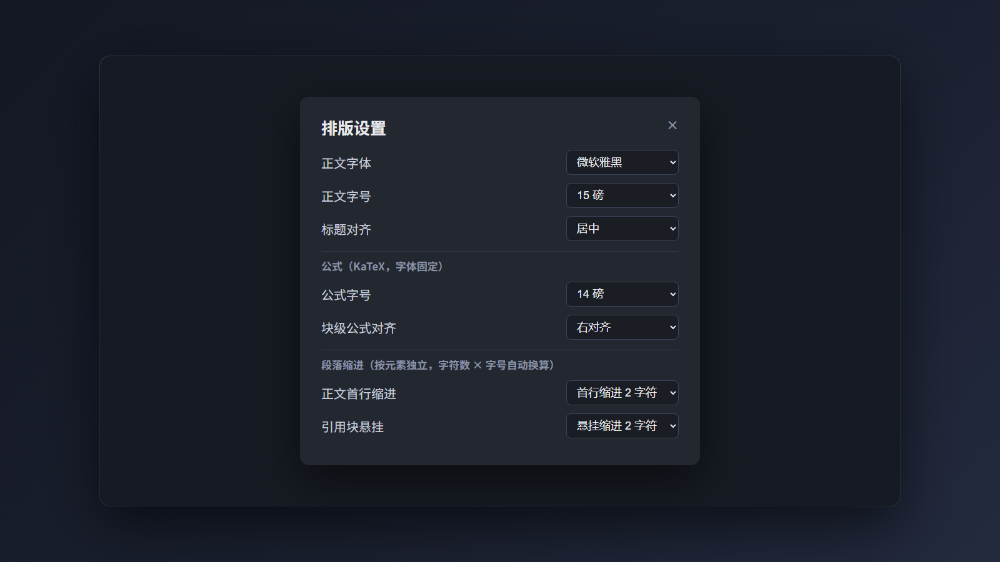
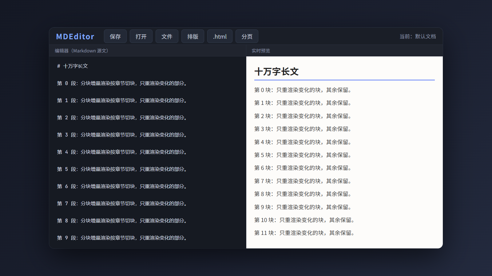
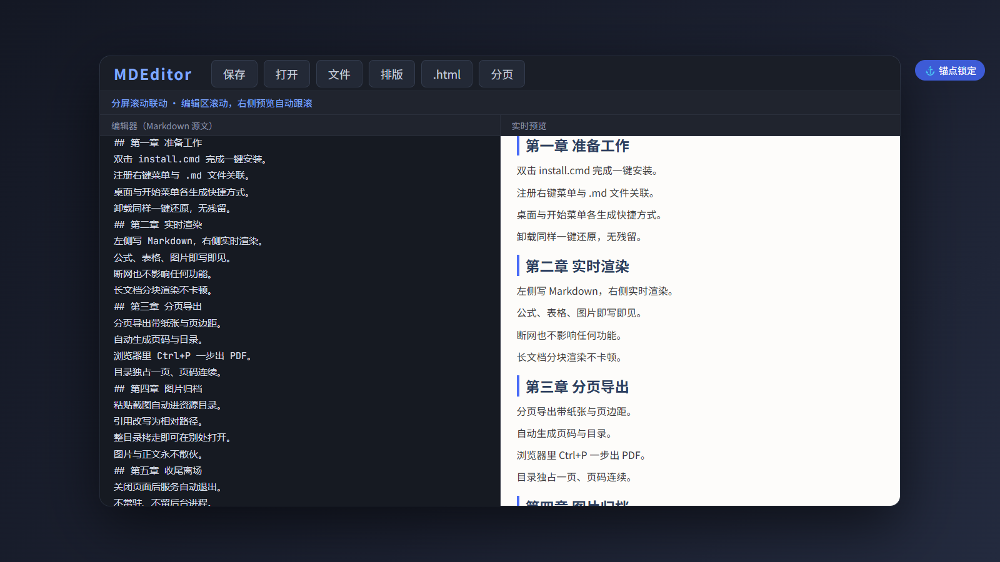
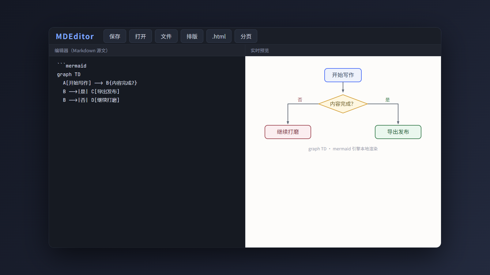
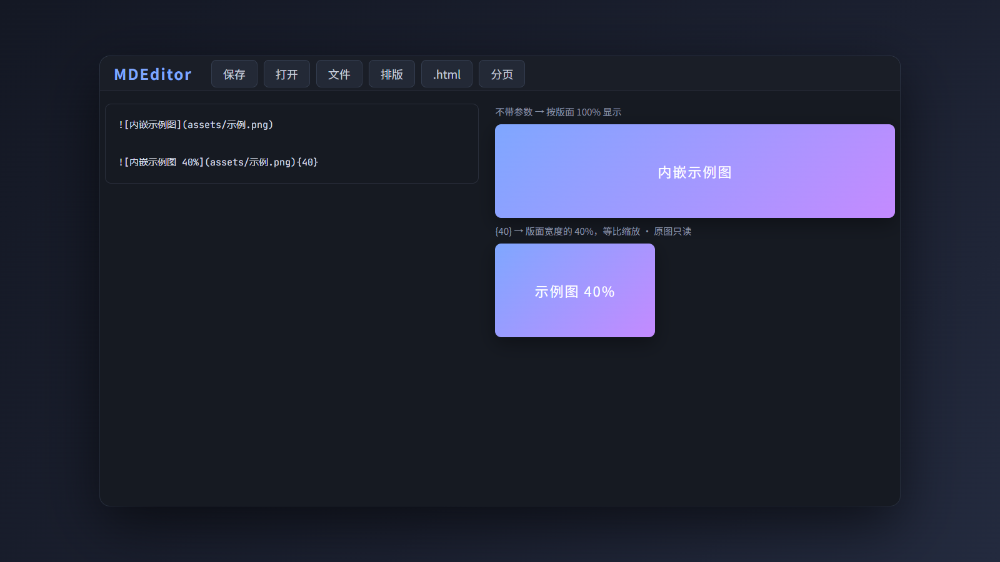
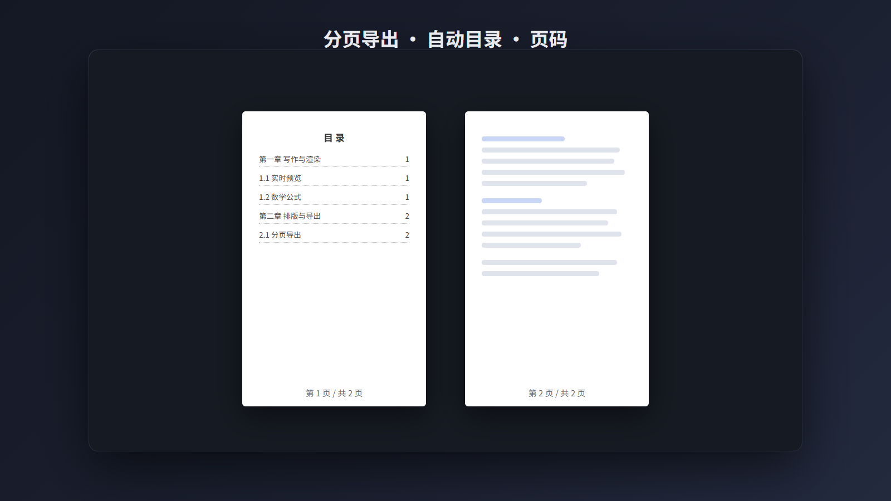
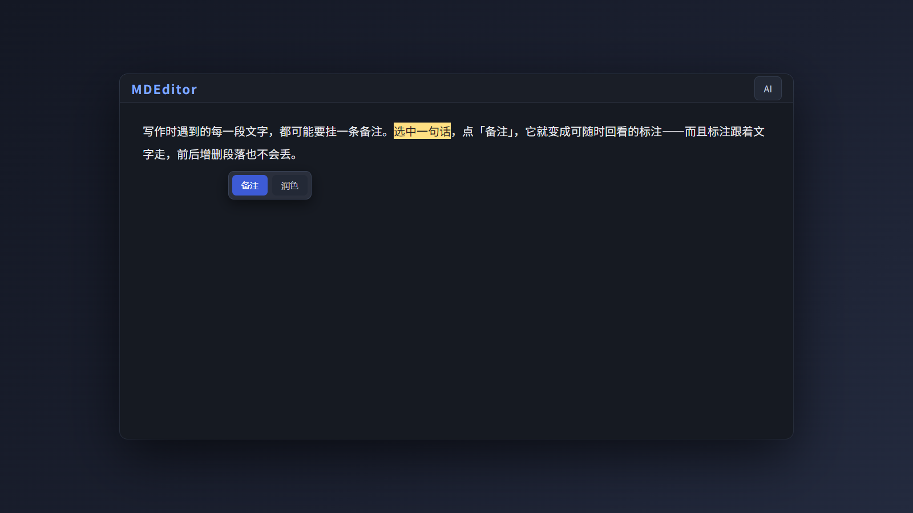
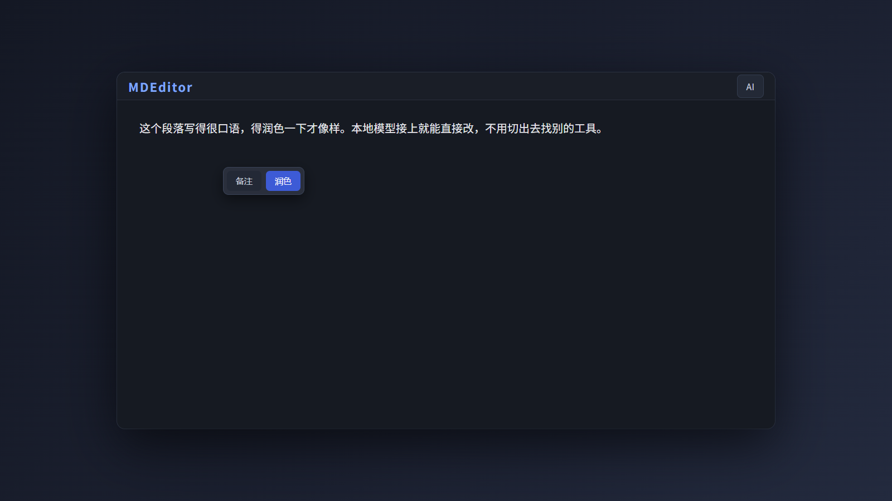

# MDWright：一个跑在自己电脑上的 Markdown 编辑器


MDWright 是一个本地 Markdown 编辑器。它不联网也能用，安装完就是一个普通的桌面工具：双击 `.md` 文件或桌面图标，它会启动一个本地服务并在浏览器里打开编辑界面。

## 左边写，右边看


编辑区在左，渲染结果在右。Markdown 的常用语法——加粗、斜体、行内代码、列表、表格——都是即写即见。KaTeX 公式本地渲染，行内公式和块级公式都能直接预览，断网也不受影响。无序列表的标记各有语义：`+` 出实心圆点、`-` 出空心圆圈，样式跟标记符走。

## 排版是设置出来的，不是手调出来的



工具栏的「排版」面板把字体、字号、对齐方式按元素分开管理：正文、各级标题、引用块、代码块各自独立，段落缩进按"字符数 × 字号"自动换算。公式部分有单独的字号和对齐设置。改一次设置，整篇文档和导出结果同步生效。

## 长文档不卡



渲染引擎按章节把文档分块，编辑时只重绘变化的那一块。十万字的文档不会因为越写越长而越写越卡。

## 分屏滚动联动



在分屏（左编辑器 / 右预览）模式下，**滚动左侧编辑区，右侧预览自动跟滚**——这是单向联动，预览滚动不会回牵编辑区。联动以**标题为硬锚**：编辑区滚到某个标题附近，预览精确锁定到该标题；两个标题之间按滚动百分比平滑过渡。哪怕文档里夹着一张几十行的大表格，预览也能连续扫过、不跳段、不丢行。不想联动时，工具栏的「跟随」开关一键关掉。

## 四种图表，写在围栏里就出图



画流程图、依赖拓扑、波形、统计图，不用开任何外部工具：直接在文档里写 ` ```mermaid `、` ```dot `、` ```wavedrom `、` ```vega ` 围栏，右侧预览立即出图。四种图表引擎全部本地部署，**按需懒加载**（文档里没有图就零开销），断网照样渲染；暗色 / 亮色主题切换时图会按新主题重绘。

## 图片宽度 {N}：版面说了算



图片引用后面跟一个 `{数字}`，这张图的宽度就等于**版面宽度的百分比**（`{40}` 即版面的 40%，等比缩放）。基准是版面而不是原图——不同大小的原图，同参数即等宽；图表围栏也支持同一参数。**原始图片文件只读不写**，参数只决定显示与排版尺寸；分页导出时超长图先按参数定宽、再按调整后的高度切片续排。

## 导出就是成品



需要打印或分发时，「分页」导出会生成带纸张设置、页边距、页码和自动目录的分页版 HTML，浏览器里 Ctrl+P 直接出 PDF。也可以导出纯 Markdown 或带样式的单文件 HTML。

## 选区批注，标注跟文字走



写作时选中一段文字，浮动工具条点「备注」即可加批注，被标注处显示为虚线加淡底色。关键是**标注跟文本走，不跟位置走**：前后插入、增删段落，批注随文字移动不丢失；片段被删光时该批注自动失效。点正文里的虚线段，随时查看、编辑、删除，或让 AI 解释这一段。批注随文档一起保存。

## AI 润色，确认后才改动



选中片段，浮动工具条点「润色」，AI 改写结果先弹出**原文 / 新文对照**预览（新文还能先手动微调），点「替换原文」才写回——绝不未经确认直接改动你的文字。润色与 AI 解释都对接**本地 LLM**（LM Studio / Ollama），只发往你设置的本机地址，不经任何第三方。

## 图片不用管，它自己归档

写作时粘贴截图，图片会自动存进与文档同名的资源目录（`文档名.assets\`），正文里的引用自动写成相对路径。`.md` 和 `.assets\` 是一对，整个文件夹拷走，到哪都能打开。

## 关掉就走，不留后台


双击 `.md` 文件或桌面图标即可打开；关闭页面之后，背后的本地服务会在确认无人使用后自动退出，不常驻、不留后台进程。`install.cmd` 一键完成 .md 文件关联和桌面快捷方式注册。

工具内置「版权与开源组件声明」文档，KaTeX、Paged.js、Python 的许可文本随附在 `LICENSES/` 目录。本工具由 AI 辅助生成。

---

*宣传视频：`MDWright-intro.mp4`（约 100 秒，1600×900）。本文配图取自视频对应场景，隐去底部字幕条。*
