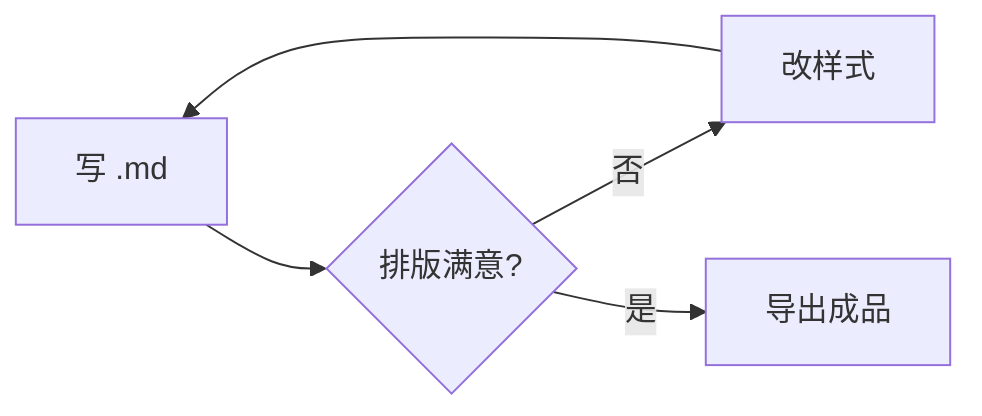
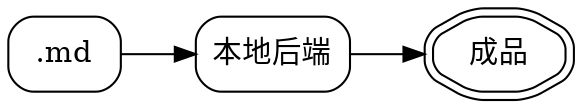

# 图表引擎

一份 `.md` 里同时放流程图、网络图与数据图，**全部离线渲染**，不联网、不上传。





```vega-lite
{
  "width": 360, "height": 130,
  "data": {"values": [
    {"月": "7月", "字数": 12800}, {"月": "8月", "字数": 21400},
    {"月": "9月", "字数": 18600}, {"月": "10月", "字数": 26500}
  ]},
  "mark": {"type": "bar", "color": "#3b6ea5"},
  "encoding": {
    "x": {"field": "月", "type": "ordinal",
          "sort": ["7月", "8月", "9月", "10月"],
          "axis": {"labelAngle": 0, "labelFontSize": 11}},
    "y": {"field": "字数", "type": "quantitative",
          "axis": {"labelFontSize": 11, "titleFontSize": 11}}
  },
  "config": {"view": {"stroke": null}}
}
```
