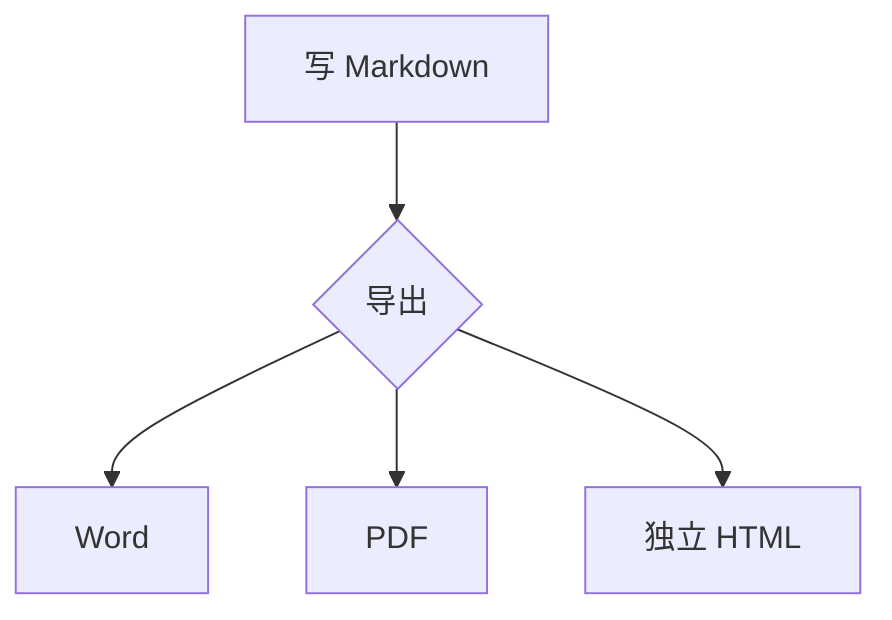

# 一级标题：版面与中文版式

这一段用来检查首行缩进 2 字符与 1.5 倍行距。如果正文只有一行，缩进仍然应该看得见。再补一句话，让这一段至少折成两行：中文排版的首行缩进是以字符为单位的，跟着正文字号走，不是固定的厘米数。

第二段用来对照段间距。两段之间不应该出现额外的大空隙，行距应当保持一致。

## 二级标题：标题层级

### 三级标题：代码与引用

行内代码：`pandoc -f docx -t markdown`；行内公式：$E = mc^2$。

```r
# 代码块：有边框、浅灰底、左侧缩进、五号字
x <- 1:10
mean(x)
```

> 这是一段引用。引用块左侧应该有一条竖线，引用内的文字不应该有首行缩进。

### 三级标题：列表与表格

- 无序列表第一项
- 无序列表第二项，稍微长一点，看看换行后的缩进
- 无序列表第三项

1. 有序列表第一项
2. 有序列表第二项
3. 有序列表第三项

| 序号 | 项目 | 说明 | 备注 |
|---|---|---|---|
| 1 | 版面 | A4 + 25/18/25/18mm | 与分页面板一致 |
| 2 | 中文版式 | 缩进 / 行距 / 标题 | 默认开启 |
| 3 | 三线表 | 上、下、表头下三条线 | 表头带底色 |
| 4 | 编号 | 1 / 1.1 / 1.1.1 | 可选 |
| 5 | 页码 | PAGE / NUMPAGES 域 | 可选 |

窄表（更容易看出表格整体居中）：

| 项目 | 值 |
|---|---|
| 表格对齐 | 居中 |
| 三线表 | 开 |

### 三级标题：其它语法

提示块：

> [!NOTE]
> 这是一条 NOTE 提示块，Word 里应该落成引用块 + 加粗的「NOTE」。

> [!WARNING]
> 这是一条 WARNING 提示块，用来确认五种类型都能识别。

脚注引用[^1]，以及另一个脚注[^2]。

[^1]: 这是第一条脚注，用来检查 Word 文末的脚注区。
[^2]: 这是第二条脚注，编号应当连续。

定义列表：

术语一
: 这是术语一的定义。

术语二
: 这是术语二的第二行定义。

行内标记：==高亮文字==、H~2~O、$x^2$、^{上标}、_{下标}。

块级公式：

$$
\int_0^1 x^2\,dx = \frac{1}{3}
$$

## 二级标题：图片

默认对齐（不写参数，Word 里应当居中）：


左对齐 `{l}`：

{l}

右对齐 `{r}`：

{r}

带题注（`title` 是题注，alt 不显示）：


并排两张：

@@ begin fill {50|50}


@@ end fill

## 二级标题：图表

导出前先在预览里等这张图渲染完成；渲染失败会原样落成代码块。



## 二级标题：结尾

这一节用来确认文档末尾没有多余的空页、没有残留的域。若开启了 Word 目录，目录应当包含从「一级标题」到本节的三级标题，并且标题页在目录之前。
